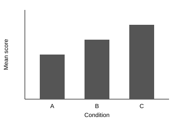

<!--
Co-authors: type your text under the headings below. Leave the headings themselves as they are.
Start each new sentence on its own line. How-to guide: CONTRIBUTING.md (in the main folder).
-->

# Title of the Manuscript

(Author names, affiliations and author note go here.)

## Abstract

(150–250 words.)

*Keywords:* keyword one, keyword two, keyword three

# Title of the Manuscript

(Introduction. In APA style the introduction has no "Introduction" heading; it starts under the repeated title.
State the research problem, its significance, and the objective or hypotheses.)

## Method

### Design

test 1 2 3 

### Corpus

(Describe corpus composition, preprocessing, inclusion criteria, and size.)

## Results

(Report key findings with statistics.)

Scores differed by condition (see [Table 1](../tables/table-1.md)).

Scores differed by condition (see [Table 2](../tables/table-2.md)).

**Figure 1**

*Mean Outcome Score by Condition*

*Note.* Mock data for practice only.

## Discussion

(Interpretation, limitations, and implications.)

## References

(One entry per source, in APA 7 format, alphabetical by first author. Examples:)

Author, A. A., & Author, B. B. (Year). Title of the article. *Title of Journal, 12*(3), 45–67. https://doi.org/xx.xxx/yyyy

Author, A. A. (Year). *Title of the book*. Publisher.

## Declarations

(Conflicts of interest, funding, ethics approval, data and code availability, author contributions.)
